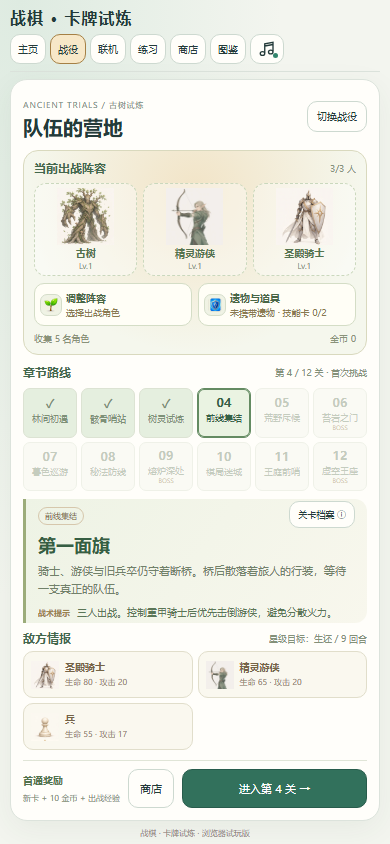
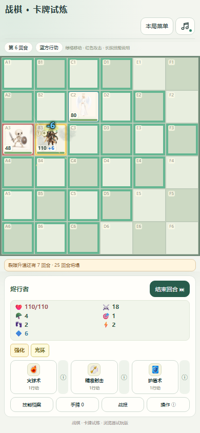

# 战棋 · 卡牌试炼

[](https://github.com/xbxfk-twh/tactics-card-trials/actions/workflows/ci.yml)

面向电脑与手机的回合制战棋：角色收集、两条战役、Boss预警、实时双人房间与离线练习。

**[在线试玩](https://guyuyizhang.top/tactics/) · [安装包与发行版](https://github.com/xbxfk-twh/tactics-card-trials/releases) · [玩法说明](apps/web/README.md)**

 

## 开始游玩或开发

需要Node.js 24。Windows可双击根目录 **启动游戏.cmd**，首次启动自动安装网页端依赖。

```sh
cd apps/web
npm ci
npm start
```

打开 `http://127.0.0.1:8080/`。只启动服务：`npm start -- --no-open`。

```sh
npm run check   # 运行文件与资源引用
npm test        # 规则、战役平衡、音效与双端联机回归
npm run build   # 根目录 dist/ 下生成离线和联机服务 ZIP
```

手机网页、电脑网页与Android包可进入同一房间；设备访客身份和战役存档不会跨设备自动同步。

## 玩法

- **古树试炼**：12关，前五关按1、2、2、3、4人扩编，角色升级、遗物和三位2×2首领。
- **余烬独行**：单主角9关，三主动、两被动、属性与技能强化，首通解锁技能并播放剧情。
- **星海会馆**：房间列表、房主简介、准备开局、断线重连和服务器保存的星图段位。
- **机巧练武庭**：离线人机，三档决策难度、快速阵容或完整选卡推演。
- **触屏操作**：全宽棋盘、紧凑属性、技能/状态说明、叠放确认、独立音量和减少动态。

## 目录

```text
apps/
  web/          网页端、规则引擎、房间服务器与测试
  android/      内置同一网页运行清单的 Android WebView 容器
docs/           架构、开发、部署说明、许可与精选截图
scripts/        公开范围与暂存文件审计
.github/        CI、Issue 和 PR 模板
```

构建产物在 `dist/`，截图、报告和再生成素材输入在 `artifacts/`，均不提交Git。历史原型、私有部署记录、玩家数据、机器缓存、原稿大包和签名密钥不属于公开源码树。

详细说明：[架构](docs/architecture.md) · [开发与测试](docs/development.md) · [部署](docs/deployment.md)。

## Android

最低Android 8.0；构建需要JDK、Python、Pillow及官方Android SDK 35 / Build Tools 35.0.0。当前脚本使用Windows SDK工具，见 [Android README](apps/android/README.md)。签名和内置资源一致性有自动验证，尚未进行真机安装测试。

## 协作与许可

见 [CONTRIBUTING.md](CONTRIBUTING.md) 和 [SECURITY.md](SECURITY.md)。CI只测试、打包，不自动部署生产服务。

本仓库公开展示源码，项目自身代码和美术目前保留所有权利，未另行授予MIT等开源许可。第三方组件遵守原许可，见 [LICENSE](LICENSE) 与 [THIRD_PARTY_NOTICES.md](THIRD_PARTY_NOTICES.md)。
